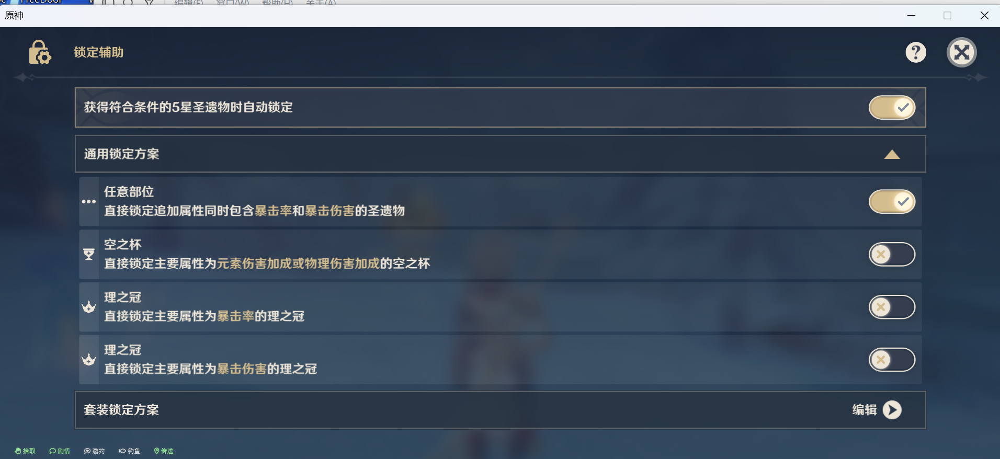

# 🔒 圣遗物锁定方案 · 严格版（46 套 · 截至 7.1）

## ✨ 脚本简介

把 **46 套五星圣遗物**的锁定方案一次性填进游戏的「锁定辅助」，配置完成后在游戏里点一次「快速锁定」，就能把背包里值得强化的胚子批量锁上。

面向**不凹分、正常养角色**的玩家：

- 主 C：五件合计双暴分 **200~240**（单件约 40~48，双暴分 = 暴击率 × 2 + 暴击伤害）—— 这是毕业线，不是本脚本的产出保证
- 辅助：**充能够用**即可，不追双暴

产出的是**候选池**，不是毕业判定。锁定可逆，强化不可逆，值不值得强化仍要你自己看。

> UI 自动化引擎来自 BetterGI 官方脚本仓库的 [AutoArtifactLockingSettings](https://github.com/babalae/bettergi-scripts-list/tree/main/repo/js/AutoArtifactLockingSettings)（bling-yshs / Bedrockx / qwecxzpoi），**代码未做任何修改**，本仓库只替换数据文件与说明。原始方案思路来自哔哩哔哩 [@酸儒书生](https://www.bilibili.com/video/BV13YHQzMEAT)。

## ⚠️ 和原版「自动配置圣遗物锁定方案」不一样的三处

用过原版的话，先看这张表，只有第一处会真的踩坑：

| # | 差异 | 原因 |
|:---:|:---|:---|
| 1 | **「通用锁定方案」只勾第 1 项**。原版要求勾 1、3、4 项，本版必须把第 3、4 项（两个「理之冠」无条件锁定）**取消** | 冠已经由套装方案按「主属性 + 副词条」精确控制；留着无条件项会把所有双暴冠锁死，套装方案再严也被冲掉 |
| 2 | **「覆盖已有方案」默认不勾**，且首次安装不需要勾 | 它是「删除旧方案再重建」。首次安装游戏里没有方案，勾了反而多做删除动作 |
| 3 | 全量 92 个方案，约 **30~45 分钟**，建议分 3 批 | 原版 89 个方案；本版血红/翠绿/炉火由 1 个方案增为 2 个 |

## 📖 使用步骤

### 1️⃣ 前置要求

- 游戏分辨率设置为 **16:9**（2560x1440 或 1920x1080），不要缩放画面
- 游戏语言设置为**简体中文**
- 游戏版本 **≥ 5.2**，BetterGI 版本 **≥ 0.56.2**
- 圣遗物「锁定辅助」页面的「通用锁定方案」按下图设置：**只勾第 1 项，取消第 3、4 项**

  

  | 项目 | 设置 |
  |:---|:---|
  | 任意部位：追加属性同时含暴击率和暴击伤害 | ✅ 勾选（散件兜底） |
  | 空之杯：主属性为元素伤害加成或物理伤害加成 | ❌ 取消 |
  | 理之冠：主属性为暴击率 | ❌ 取消 |
  | 理之冠：主属性为暴击伤害 | ❌ 取消 |

### 2️⃣ 配置选项

在「调度器」中打开脚本设置，配置以下选项：

| 选项 | 说明 |
|:---|:---|
| 覆盖已有方案 | 勾选后会删除已有方案并重新配置。首次安装**不需要勾**；手工调过方案的话勾了会被清掉 |
| 延迟系数 | 默认 1.2，运行不稳定时可调高至 1.4 或更高 |
| 需要配置的圣遗物套装 | 勾选需要配置的套装，支持全选。默认只勾了「角斗士的终幕礼」用于试跑，**不建议第一次就全选** |

### 3️⃣ 运行脚本

1. 把整个文件夹放进 `BetterGI\User\JsScript\`（BGI 左侧「JS脚本」页有「打开目录」按钮）
   - 解压后确认 `main.js`、`manifest.json`、`圣遗物锁定方案信息.json` 与 `assets` 文件夹**同级**，不要多套一层文件夹
2. 回到「JS脚本」页点刷新；若列表里没有「圣遗物锁定方案-严格版」，再完全退出 BGI 重开
3. 在「调度器」中添加任务 → 类型选 **Javascript** → 脚本选 **圣遗物锁定方案-严格版**
4. 游戏里打开背包 → 圣遗物页（能看到 8×4 网格），切回 BGI 运行脚本
5. 等待脚本自动完成所有配置。运行期间请勿操作鼠标键盘
6. 跑完回游戏 → 锁定辅助 → 点 **快速锁定**

> 全量 92 个方案约 30~45 分钟。建议分 3 批（输出套 33 套 / 精通与充能辅助 7 套 / 治疗与特殊辅助 6 套），每批仍会扫一遍套装列表，但只配置勾选的套装。
>
> 本脚本与官方脚本仓库的「自动配置圣遗物锁定方案」修改的是同一批方案。两者请只保留一个，或至少不要在同一次配置里混跑。

## 📦 支持的套装（46 套）

### A 组 · 双暴输出（33 套，每套 2 个方案）

花、羽、沙、杯的星标为 **★暴击率 ★暴击伤害**（双暴齐才锁）。冠拆两个方案：主暴击率 + 星标暴伤 / 主暴伤 + 星标暴击率，并额外要求池内命中一条（攻击% / 精通 / 生命% / 防御%）。

| 套装 | 时之沙 | 空之杯 |
|:---|:---|:---|
| 角斗士的终幕礼 | 攻击% | 伤害加成(全) · 攻击% |
| 流浪大地的乐团 | 精通 · 攻击% | 伤害加成(全) · 攻击% |
| 炽烈的炎之魔女 | 攻击% · 精通 · 生命% | 火伤 · 攻击% |
| 冰风迷途的勇士 | 攻击% | 冰伤 · 攻击% |
| 沉沦之心 | 攻击% | 水伤 · 攻击% |
| 如雷的盛怒 | 攻击% · 精通 | 雷伤 · 攻击% |
| 苍白之火 | 攻击% | 物伤 · 攻击% |
| 追忆之注连 | 攻击% · 生命% | 伤害加成(全) · 攻击% |
| 辰砂往生录 | 攻击% | 伤害加成(全) · 攻击% |
| 来歆余响 | 攻击% | 伤害加成(全) · 攻击% |
| 绝缘之旗印 | 充能 · 生命% · 攻击% | 伤害加成(全) |
| 沙上楼阁史话 | 攻击% | 风伤 · 攻击% |
| 水仙之梦 | 攻击% · 精通 | 水伤 · 攻击% |
| 逐影猎人 | 攻击% · 生命% | 伤害加成(全) · 生命% |
| 黄金剧团 | 攻击% · 精通 · 生命% · 充能 | 伤害加成(全) · 生命% |
| 逆飞的流星 | 攻击% · 防御% | 伤害加成(全) |
| 染血的骑士道 | 攻击% | 物伤 · 攻击% |
| 渡过烈火的贤人 | 攻击% | 火伤 · 攻击% |
| 平息鸣雷的尊者 | 攻击% | 雷伤 · 攻击% |
| 悠古的磐岩 | 防御% · 攻击% · 充能 | 岩伤 · 防御% |
| 回声之林夜话 | 攻击% | 岩伤 · 攻击% |
| 未竟的遐思 | 攻击% | 伤害加成(全) · 攻击% |
| 谐律异想断章 | 攻击% | 伤害加成(全) |
| 饰金之梦 | 精通 · 攻击% | 精通 · 伤害加成(全) |
| 花海甘露之光 | 生命% · 充能 | 生命% · 伤害加成(全) |
| 华馆梦醒形骸记 | 防御% · 充能 | 岩伤 · 防御% |
| 黑曜秘典 | 攻击% · 生命% | 伤害加成(全) · 攻击% · 生命% |
| 长夜之誓 | 攻击% | 伤害加成(全) |
| 深廊终曲 | 攻击% | 冰伤 · 攻击% |
| 穹境示现之夜 | 精通 · 攻击% | 精通 · 伤害加成(全) |
| 风起之日 | 攻击% | 伤害加成(全) · 攻击% |
| 血红之证 | 攻击% · 精通 | 攻击% · 精通 · 风伤 |
| 影中沉凝的幻灭 | 攻击% · 精通 | 冰伤 · 物伤 · 攻击% · 精通 |

> 「伤害加成(全)」用的是游戏里的**全选**，等于 7 种元素伤 + 物理伤全选中，用在主人不固定的通用套上；元素专精套只勾对应那一种。
> 花、羽固定为：主属性固定生命值 / 攻击力，星标双暴。

### B 组 · 精通（4 套，各 2 个方案）

| 套装 | 时之沙 | 空之杯 | 理之冠 |
|:---|:---|:---|:---|
| 翠绿之影 | 精通 / 充能 | 精通 | 精通 |
| 深林的记忆 | 精通 / 充能 | 精通 · 草伤 | 精通 |
| 乐园遗落之花 | 精通 / 充能 | 精通 | 精通 |
| 晨星与月的晓歌 | 精通（两方案相同） | 方案一 精通 / 方案二 伤害加成(全) | 暴击率 · 暴击伤害 |

前 3 套：花、羽星标 ★精通 ★充能；沙拆两个方案（精通沙 + 星标充能 / 充能沙 + 星标精通）；杯、冠主属性为精通，星标充能。
晨星不同：花、羽星标 ★精通 ★暴伤，沙星标暴伤，冠主双暴 + 星标精通；方案二把空之杯换成伤害加成(全) 并要求双暴，用于把「元素伤杯 + 双暴」当散件留下。

### C 组 · 充能辅助（3 套）

| 套装 | 方案数 | 时之沙 | 空之杯 | 理之冠 |
|:---|:---:|:---|:---|:---|
| 昔日宗室之仪 | 2 | 生命% / 充能 | 生命% · 攻击% · 防御% | 生命% · 攻击% · 治疗 |
| 天之美赐 | 3 | 攻击% / 充能 / 精通 | 攻击% · 精通 · 生命% | 攻击% · 精通 · 生命% · 治疗 |
| 纺月的夜歌 | 1 | 充能（星标精通） | 精通 · 生命% | 精通 · 暴击率 · 暴击伤害 |

宗室与天美：方案一「沙主 = 核心属性、星标充能」，方案二「沙主 = 充能、星标核心」。天美第三个方案是精通沙 + 星标攻击%。纺月只有一个方案，按「沙主充能 + 星标精通」。

### D 组 · 治疗 / 生命辅助（4 套，各 2 个方案）

花、羽星标 ★生命% ★充能；沙拆「生命% / 充能」两方案；杯、冠主属性含攻击%，星标充能。

| 套装 | 时之沙 | 空之杯 | 理之冠 |
|:---|:---|:---|:---|
| 千岩牢固 | 生命% / 充能 | 生命% · 攻击% | 生命% · 治疗 |
| 被怜爱的少女 | 生命% / 充能 | 生命% · 攻击% | 治疗 · 生命% · 攻击% |
| 海染砗磲 | 生命% / 充能 | 生命% · 攻击% | 治疗 · 生命% · 攻击% |
| 昔时之歌 | 生命% / 充能 | 生命% · 攻击% | 治疗 · 生命% · 攻击% |

> 千岩的冠只勾生命% 与治疗，不含攻击%。

### E 组 · 特殊辅助（2 套，各 2 个方案）

| 套装 | 方案一 | 方案二 |
|:---|:---|:---|
| 烬城勇者绘卷 | 防御向：沙 充能/防御%（星标生命%），杯 防御%，冠 治疗/防御%（星标充能） | 攻击向：沙/杯/冠 攻击%，星标充能 |
| 炉火融炼之心 | 攻击向：沙/杯/冠 攻击%，星标充能 | 精通向：沙/杯 精通，冠 精通/双暴，星标充能 |

## ✅ 跑完之后验证

1. **角斗士的终幕礼**：2 个方案，冠主属性分别是暴击率 / 暴击伤害，星标 ✦ 亮在另一种暴上
2. **深林的记忆**：2 个方案，时之沙分别是精通 / 充能
3. **天之美赐**：3 个页签，第三个是精通向
4. **昔日宗室之仪**：时之沙的两个方案分别是生命% / 充能
5. 点一次「快速锁定」，看单套锁进来的数量：应为几十件量级。若上千，说明星标没打上

## ↩️ 出问题了怎么回滚

- **删掉脚本写入的方案**：锁定辅助 → 套装锁定方案 → 选中该套装 → **快速删除方案**（5.2 新增）
- **已经锁上的圣遗物不会因为删方案而解锁**，需要在圣遗物列表里手动解锁或批量解锁
- **覆盖是逐页签「先删后建」**：若中途中断（OCR 失败、误触、掉帧），该页签会留空，重新运行即可补齐；重复运行是幂等的

## ⚠️ 已知限制

1. **只看词条种类，不看数值档位**。按五星初始词条 4 档等概率估算，双暴齐的件里约 **43.7%**（= 1 − (3/4)²）至少有一条暴击是最低档；若双暴各只吃到 4~5 次强化，+20 时双暴分约 26~30（模型估算，未做大规模实测）。所以大多数锁定件达不到 40 分，需要强化后再筛。
2. **快速锁定是持续性动作**。规则留在游戏里，你手动解开的垃圾件下次点快速锁定会被重新锁上。建议配好规则后只扫一次，之后手动管理。
3. **漏锁可以补救**：先把手上的件强化到 +4 / +8，再点一次快速锁定，第 4 条副词条开出暴击的件会被自动补上。
4. **单元素杯命中率低**（主属性约 1/12）。A 组 12 套带单元素杯的套装都额外补了「攻击%杯」兜底；精通三套（翠绿 / 深林 / 乐园）不加攻击%，因为精通杯收益更高。
5. **星标无法表达「或」**，只能用主属性多选和 N 条数间接表达。
6. **主属性识别依赖 OCR**，识别失败时该部位的主属性会被跳过，结果是漏锁而不是误锁。

## 🔬 设计说明：判据是怎么来的

锁定辅助每个部位只有两个旋钮，外加一条游戏规则：

| 项 | 语义 | 逻辑 |
|:---|:---|:---|
| **必选条件（星标 ✦）** | 该词条必须存在 | **且** |
| **任意 N 条** | 勾选词条里命中 ≥ N | **或** |
| 游戏规则 | 只有 3 条副词条的圣遗物，所需数量 **减 1** | 只作用于 N |

本方案建立在一条实测结论上：**「任意 N 条」的计数包含星标词条本身**。因此星标 2 条 + N=1 时 N 永远满足，只有「星标 1 条 + 池 3 条 + N=2」才真正等于「星标 + 至少再中 1 条」。

实际用到的组合（460 个部位）：

| 组合 | 数量 | 用在哪 |
|:---|:---:|:---|
| 双星标 + N=1 | 268 | A 组花/羽/沙/杯，B 组花/羽 —— 星标全中即锁 |
| 单星标 + N=2 | 142 | 各组的冠，以及辅助套的杯/冠 —— 星标 + 再中一条 |
| 双星标 + N=2 | 36 | 辅助套花/羽 —— 星标已满足 N，实际等同 N=1 |
| 单星标 + N=1 | 13 | 沙主属性本身就是核心属性时（如充能沙 + 星标精通） |
| 双星标 + N=3 | 1 | 晨星方案二空之杯 —— 双暴 + 池内再中一条 |

**怎么自测这条结论**：跑完后找一件「理之冠 · 主属性暴击率 · 副词条只有暴击伤害 + 两条固定值」的件，点快速锁定——

- 它被锁了 → N 实际只要求星标（本方案的建模成立）
- 没被锁 → N=2 真的要求「星标 + 再中一条」，则 N=2 部位会偏严、出现漏锁，请反馈

判据层面与原版的差异（纯操作差异见开头的三处）：

| # | 改动 |
|:---|:---|
| 1 | **关闭全部推荐方案**（原版 41/46 套开启），判据不再由游戏维护、随版本变动 |
| 2 | 改以**星标**为主轴，不再用「任选 2~3 条命中」凑数 |
| 3 | **剔除固定值词条**，不让垃圾件靠固定攻击/生命/防御凑数 |
| 4 | 按套装定位分组，不共用一套阈值 |
| 5 | 主属性按该套主人实际在用的勾选，不勾无关项；元素杯额外补攻击%兜底（相对原版是放宽，用于承接非本命套的双暴杯） |
| 6 | **每套方案数不少于原版**（合计 89 → 92），覆盖时不会留下旧页签继续生效 |

## ❓ 常见问题

**Q：为什么「覆盖已有方案」默认不勾？**
它会把已存在的方案**删掉重建**。首次安装不用勾；手工调过方案的话，勾了会被清掉，所以默认关着。

**Q：能不能只跑某一套？**
可以，设置里只勾那一套。脚本仍会扫一遍套装列表（约 1~2 分钟）。

**Q：为什么新获得的圣遗物没有自动锁定？**
「获得符合条件的 5 星圣遗物时自动锁定」是游戏自带开关，本脚本不控制它。需要自动锁定请在锁定辅助页打开该开关。

**Q：想自己改阈值怎么办？**
`tools/gen_scheme.py` 是生成器，改里面的套装表后运行即可重新生成 `圣遗物锁定方案信息.json`。生成器带断言：星标与主属性同名、空星标、主属性非法、N 大于可选词条数都会直接报错并拒绝写出文件。注意脚本更新会覆盖这些文件，自改请自行备份。

## 💬 问题反馈

1. 日志路径：BetterGI 安装目录 `log\better-genshin-impact年月日.log`
2. 附带截图（BGI 左下角的报错信息）
3. 提 issue 时说明：游戏分辨率、BGI 版本、出问题的套装名、日志片段

## 📝 更新日志

- **1.0.0**（2026-11-03）
  - 首个版本：46 套五星圣遗物，92 个锁定方案
  - 以「必选条件（星标）」为核心；冠与辅助套杯/冠引入 N=2 第二道门槛
  - 关闭全部推荐方案，剔除固定值词条
  - 每套方案数不少于原版，避免残留旧页签继续生效
  - 保留 3 个 OCR 别名（晨星与月的 / 勇者 / 海染）
  - 由内部迭代版 0.4.0 整理而来，判据逻辑无变化

## 🙏 致谢

- **UI 自动化引擎**：[AutoArtifactLockingSettings](https://github.com/babalae/bettergi-scripts-list/tree/main/repo/js/AutoArtifactLockingSettings) · [bling-yshs](https://github.com/bling-yshs)、[Bedrockx](https://github.com/Bedrockx)、[qwecxzpoi](https://github.com/qwecxzpoi)
- **原始锁定方案思路**：哔哩哔哩 [@酸儒书生](https://space.bilibili.com/10411008) 的[这期视频](https://www.bilibili.com/video/BV13YHQzMEAT)
- **宿主工具**：[BetterGI](https://github.com/babalae/better-genshin-impact)

## 👥 作者

- [pugzzh](https://github.com/pugzzh) —— 46 套方案数据、严格化判据、生成器
- [bling-yshs](https://github.com/bling-yshs)、[Bedrockx](https://github.com/Bedrockx)、[qwecxzpoi](https://github.com/qwecxzpoi) —— 脚本引擎

## 📄 许可

- `main.js`、`lib.js`、`ui_coordinates.json` 的版权归原作者，来自 BetterGI 官方脚本仓库的 AutoArtifactLockingSettings，本仓库为保证脚本可直接运行而随附，**未做任何修改**，也不对其另作授权。
- 本仓库新增的 `圣遗物锁定方案信息.json`、`settings.json` 与 `tools/gen_scheme.py` 可自由使用、修改与再分发，保留本节署名即可。
